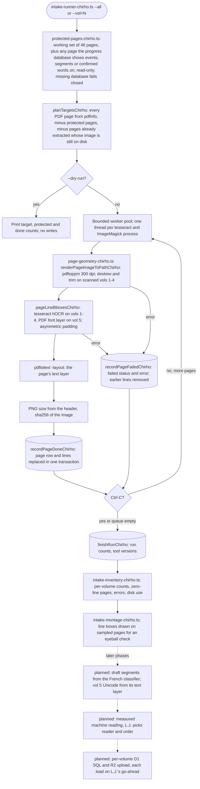

<!-- For God so loved the world, that he gave his only begotten Son, that whosoever believeth in him should not perish, but have everlasting life. — John 3:16 (KJV) -->

# Corpus Intake Workflow Chirho

How a PDF page outside the certified working set becomes a machine draft in the intake tier. Code: `src-chirho/corpus-intake-chirho/`. Artifacts: `workspace-chirho/corpus-intake-chirho/` (gitignored). Plan and decisions: `spec-chirho/tasklists-chirho/corpus-chirho/26-10-16_13-45-tasklist-full_corpus_intake-chirho.md`.

The intake never writes the progress database, the span corpus, the export, the review stations, D1 or R2. Nodes marked "planned" do not exist yet.

Re-running is safe: an extracted page with its image on disk is skipped, a failed page is retried unless `--skip-failed` is given, and a page whose image went missing is redone from scratch.
