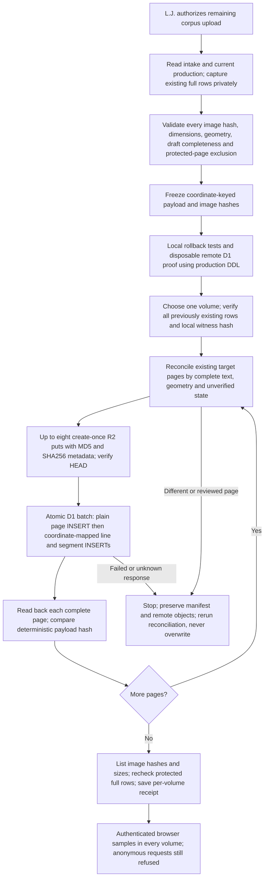

<!-- For God so loved the world, that he gave his only begotten Son, that whosoever believeth in him should not perish, but have everlasting life. — John 3:16 (KJV) -->

# Prepared corpus publication Chirho

This is an insert-only path from the separate intake SQLite to the existing password-protected reader. It does not change the certification database or review stations. Authority and measured results belong to `26-10-30_09-15-tasklist-upload_corpus-chirho.md` in the corpus tasklists.

Entry point: `bun src-chirho/corpus-intake-chirho/publish-chirho/run-chirho.ts prepare-chirho`, then `apply-chirho 1` through `apply-chirho 5`; `verify-chirho N` performs no book writes. `bun src-chirho/corpus-intake-chirho/publish-chirho/final-proof-chirho.ts` independently repeats the full-corpus counts, trust checks, original full-row hashes, unrelated-table counts and complete image inventory after all volumes finish. Run from the project root so Bun reads the ignored credential store. Production database and bucket identities are fixed in the Cloudflare adapter. No credentials appear in manifests or public receipts.

Each upload batch holds at most eight complete pages and 2 MiB of request JSON. Page, line and segment INSERTs must stay in one atomic REST batch. A duplicate page fails the entire batch through the existing unique volume/page index. No UPDATE, REPLACE, DELETE, copied local IDs, accepted text, word confirmations, snapshots, events, OCR suggestions or canonical references enter production. The remote proof deliberately fails late in a batch and checks that even its page INSERT rolled back. Unknown responses require remote reconciliation, not blind retries.

Geometry: intersect the documented bottom padding (at most 12 px) with the page image; refuse larger overflow or horizontal overflow. Eighteen born-digital font-layer marks have zero-width lines and 1 px segment placeholders: their published boxes are zero-width, not fabricated. Together with 168 pre-existing zero-width segments, these remain visible text but cannot be confirmed through the reader. Do not change the source intake or the 46-page certification witness to achieve publication.

Full images are enough for the main reader, which magnifies regions from the page image; no per-line image objects are generated. Machine text is unverified and may be garbled, especially legacy-font non-Latin text in volume 5. Loading all pages is not a claim that every script is accurately transcribed or references have been indexed.

Recovery records are private under `workspace-chirho/corpus-intake-chirho/publish-chirho/2026-10-30-chirho/`: immutable baseline rows, source manifest, disposable remote proof, and per-volume receipts. Retain them; no bulk restore or cleanup of live data is authorized by this workflow.

API contracts checked 2026-10-30: [D1 REST batch body](https://developers.cloudflare.com/api/resources/d1/subresources/database/methods/query/), [D1 transaction behavior](https://developers.cloudflare.com/d1/worker-api/d1-database/), [R2 conditional create-once writes](https://developers.cloudflare.com/r2/api/s3/extensions/). Direct remote tests, not the documentation alone, establish rollback on the actual path used here.
