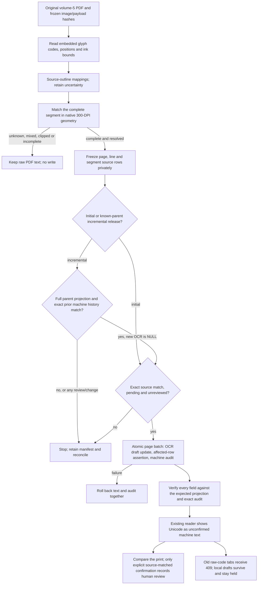

<!-- For God so loved the world, that he gave his only begotten Son, that whosoever believeth in him should not perish, but have everlasting life. — John 3:16 (KJV) -->

# Source-font machine drafts Chirho

## Boundary

This lane uses `segments_chirho.ocr_text_chirho`, never the raw `pdftotext_chirho`, accepted text, status, canonical fields or page/line geometry. Only volume 5's 1,004 native-coordinate reader pages are in scope. The five earlier reviewed pages 148–152 are excluded. The original 21 pilot page rows remain intact; their newly appended pending reader segments may receive drafts.

All source rows come from the frozen full-corpus/legacy projections and are compared with production before preparing a manifest. The initial release refuses pages with events, words, snippets, snapshots, approved lines, accepted readings, existing OCR or review state. Its full target-row/parent-line comparison runs in the same D1 transaction as the update. The incremental Greek release references that immutable parent, requires its entire page/line/segment projection plus byte-matching machine audit history, and fills only still-NULL Greek OCR fields with disjoint glyph coverage. It cannot overwrite an earlier draft, accept a new human/review event, or rebase against changed data. SQL compares every captured field and page-bounded row count, not just the new target text. An ignored UPDATE or failed audit INSERT rolls back the entire page. Work is bounded to eight disjoint pages at a time; all in-flight requests settle before a failure stops the next window.

The machine event is `page-machine-font-decoded-chirho`, actor `font-decoder-chirho`, aggregate `page-chirho`, with no word/scanline id. Its payload records the decoder version, manifest, PDF, image, original payload and target hashes, and `approved_chirho=false`. It is not a confirmation receipt. Event sync ignores its word projection because it has no word id; it is not copied into the training/certification progress database.

## Mapping evidence and limits

`vol5_fonts_chirho/` reads the embedded NewJerusalemU and SymbolGreekU outlines. Hebrew rules retain prior behavior, with glyph coverage added across operator boundaries. Greek reads left-to-right; literal spaces, accents and iota subscripts are preserved for resolved glyphs. Compare Greek identities with the [Unicode Greek Extended chart](https://www.unicode.org/charts/PDF/U1F00.pdf), but use the embedded print outlines as the source witness.

The enlarged Greek comparison disproved several initial readings. The first release made only 68 resolved main codes eligible and held all main breathing glyphs. The follow-up resolves all 141 main codes from exact repeated contours, with eight independently read breathing anchors; the 68 previously published identities remain unchanged. See `spec-chirho/page-reader-checks-chirho/proof-chirho/font-drafts-chirho/greek-anchor-review-chirho.md`. The companion's Latin/punctuation outlines were also inspected. Unknown codes and standalone unattached accents cannot become eligible through a familiar biblical spelling. Syriac remains unsupported; French ligatures and mixed-font segments remain separate work. Unicode output remains a machine draft, not a claim of exact vocalization or print certification.

Pixel checks use pinned full-page scans, with padded lines from PDF pp. 51, 54, 56, 65, 200, 500 and 900. Greek examples include `γεννᾶται` (56:26) and `περινοῆσαι` (500:7); Hebrew checks include the two Job 5:7 phrases on 56:15. WLC agreement is not used to certify these readings. As a separate completeness check, the source-code character multiset must equal the stored raw segment, ignoring only whitespace/bidi controls and NFC representation. This includes invisible spacers. The driver checks every main font's actual ToUnicode range against its source encoding: Hebrew's range is ASCII identity, whereas Greek's upper bytes map to MacRoman characters, not byte-identical Unicode. The companion resources explicitly use MacRoman. This is a scope check, not a substitute for the print witness or a claim of correct word order.

## Execution and recovery

1. `publish-chirho/font-chirho/source-chirho.ts` freezes the 1,004 source projections. `segment_drafts_chirho.py` produces a page-bounded dry run. `prepare-chirho.ts` reads hosted rows without mutation and freezes a private manifest.
2. Run decoder tests, reader/intake tests, strict TypeScript, Svelte diagnostics, the real-D1 disposable transaction proof and the copied-database browser proof. The browser test's only successful confirmations target the local fixture; hosted verification never clicks Confirm.
3. Commit and scan the exact source range before `apply-chirho.ts apply-chirho`. No Worker code, schema, R2 object, credential, model, station packet or certification witness needs changing.
4. A retry must match both the complete expected OCR projection and its exact machine audit. A source conflict, unaudited existing draft or partial result is a stop, never permission to overwrite. `verify-chirho` writes no rows.
5. Preserve the private pre-state and hashes. A future rollback may clear only this release's exact OCR values while the raw/accepted/status/source still match and no intervening review exists. Do not restore a whole database or replay a fixture into production. Retire these cold manifests only after their audit retention decision; they are not build cache.

Incremental CLI: `publish-chirho/font-chirho/incremental-chirho/{prepare,apply,remote-proof}-chirho.ts`. The compact child manifest lives under `workspace-chirho/corpus-intake-chirho/greek-completion-chirho/` and pins its parent manifest and decode hashes. Its audit source is `vol5-greek-components-20261030-chirho`, retaining the parent manifest and prior-event hash. Reconciliation requires both the complete expected projection and the original history followed by exactly one matching new machine audit; an ambiguous response is never retried blindly. The shared target-letter check includes Greek Extended letters, including isolated articles such as `ὁ`.

Private evidence lives under `workspace-chirho/corpus-intake-chirho/font-decode-chirho/`. Public code/receipt contains hashes and counts, not credentials or local test-store contents. The release receipt records actual publication and hosted evidence separately from the dry-run counts.
