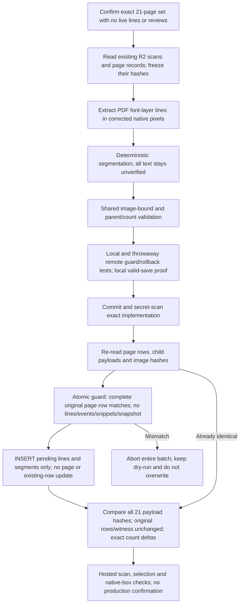

<!-- For God so loved the world, that he gave his only begotten Son, that whosoever believeth in him should not perish, but have everlasting life. — John 3:16 (KJV) -->

# Legacy pilot reader foundation Chirho

This completes the ordinary reader surface on the 21 existing volume-5 pilot pages (PDF 50-70). It is not certification, a station import, a snapshot replay, or a replacement for their existing page text/status. Authority and proof belong to `26-10-30_11-20-tasklist-legacy_reader_lines-chirho.md`.

Code: `src-chirho/corpus-intake-chirho/publish-chirho/legacy-chirho/`. Prepare with `prepare-chirho.ts`, run `remote-proof-chirho.ts`, then `apply-chirho.ts apply-chirho` or read-only `apply-chirho.ts verify-chirho`. Runtime artifacts stay in the ignored `workspace-chirho/corpus-intake-chirho/publish-chirho/legacy-2026-10-30-chirho/`. An isolated worktree supplies `HOTTP_CANONICAL_ROOT_CHIRHO` for the read-only certification-witness hash; normal main-root execution needs no override.

The existing typed page schema supplies the complete CAS column set. A missing/extra field is refused. A failed SQL guard deliberately raises a JSON error in the same D1 transaction as the two child INSERTs. Existing child data never gets replaced; an unknown outcome requires full reconciliation. Scope is fixed to volume 5 pages 50-70, with no public mutation endpoint added. Every new row is pending; accepted/OCR/canonical text, confirmations, page approval, snapshots and events are never copied into this foundation.

The corrected font-layer extractor is shared with full-corpus intake. Image dimensions and MD5/SHA256 come from the served scan itself; the publisher's geometry validator clamps only documented bottom padding and leaves unmeasurable fragments without a confirmable box. Legacy font codes can remain in Hebrew/Greek text. Confirm only by comparing the print, never because the font hint or a lexical match looks plausible.

The original full-corpus release receipt is a point-in-time count baseline. This append has its own manifest and exact count deltas; an old count proof is not silently weakened to accept arbitrary new rows. The certification witness and station packets stay unchanged.
